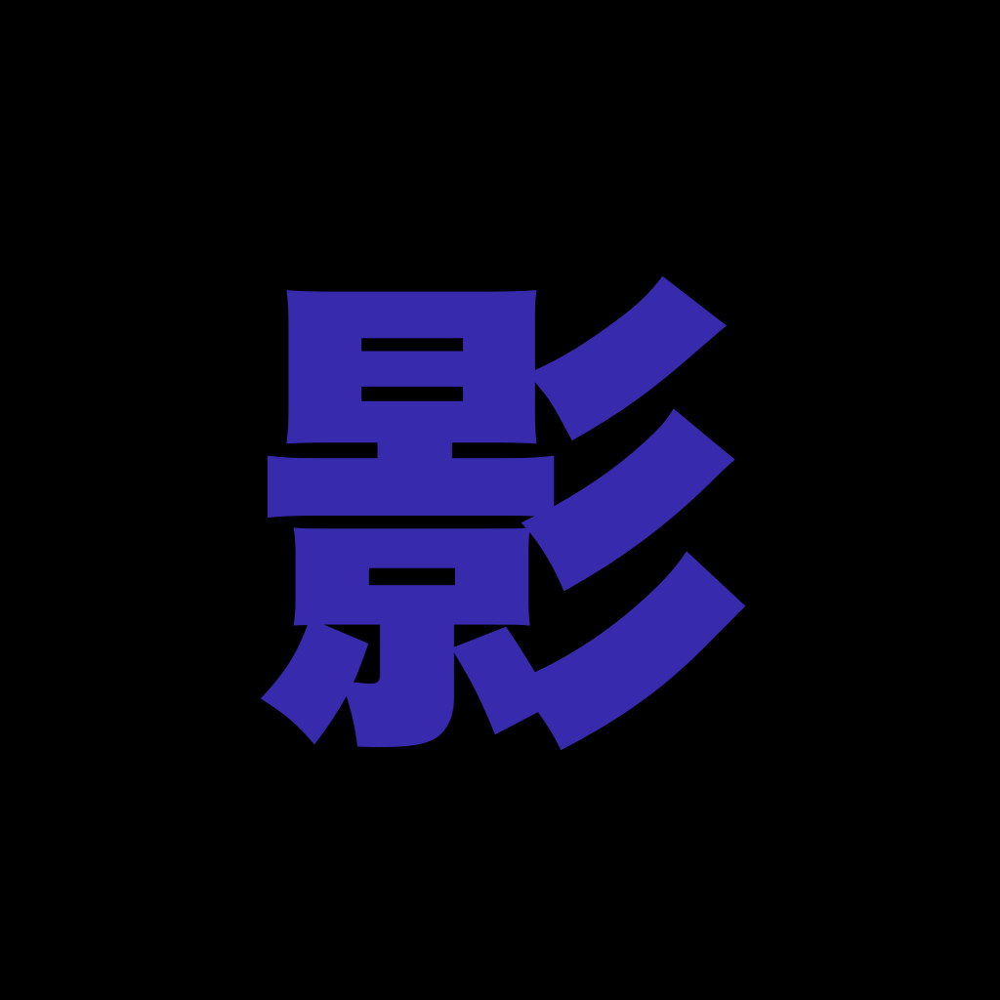

# Kage



Kage is a VPN and proxy client for **macOS, Windows, Linux, Android, and iOS**. It runs Xray directly in the app and gives you a visual editor to decide which traffic goes through the tunnel, which goes direct, and which gets blocked.

**Pronunciation:** *KAH-geh*, with a hard **g** and an **e** like the vowel in “get.” The name comes from the Japanese word 影 (かげ), meaning “shadow.” [Japanese dictionary entry](https://dictionary.cambridge.org/us/dictionary/japanese-english/%E5%BD%B1)

[Download Kage](https://github.com/Rigby-Foundation/Kage/releases) · [CLI guide](docs/cli.md) · [Plugin documentation](docs/plugins/README.md)

Kage was previously called NuggetVPN. Its app ID is now `org.rigbyfoundation.kage`. On desktop, Kage moves the previous app data folder on first launch. On Android and iOS, export a backup from the old app and import it into the new installation to transfer your profiles and settings.

## Install

| Platform | Download from Releases |
| --- | --- |
| macOS | Universal `.dmg`. Open it and drag Kage into Applications. |
| Windows | NSIS installer for x64 or ARM64. A silent installer is also available. |
| Linux | `.deb`, `.rpm`, or AppImage for x86-64. |
| Android | `.apk` for ARM64 and x86-64. |
| iOS | Unsigned `.ipa` for iOS 15 and later. Sign it with a provisioning profile that permits the Packet Tunnel Network Extension. |

The desktop install scripts download the release and verify its SHA-256 checksum.

**Windows (PowerShell)**

```powershell
irm https://raw.githubusercontent.com/Rigby-Foundation/Kage/main/scripts/install.ps1 | iex
```

**macOS and Linux**

```sh
curl -fsSL https://raw.githubusercontent.com/Rigby-Foundation/Kage/main/scripts/install.sh | sh
```

Linux needs systemd-resolved and `resolvectl` for TUN DNS. The first desktop connection asks for permission to set up the tunnel. On mobile, accept the operating system’s VPN prompt.

## Connect

1. Open **Configs → Add** and paste a subscription URL or a server share link. You can also import a QR code.
2. Select a configuration, then pick a server or use **Automatic**.
3. Open **Connection** and press **Connect**. You can switch servers while the tunnel is running.

Kage supports VLESS (including REALITY and XTLS Vision), VMess, Trojan, Shadowsocks, Hysteria 2, WireGuard, SOCKS5, and HTTP. Supported transports include TCP, WebSocket, gRPC, HTTPUpgrade, and XHTTP. Subscriptions can include server groups, descriptions, and usage and expiry information. The default subscription User-Agent is `Kage/3.0.0` and can be changed in Settings.

### Import links with `kage://`

A subscription provider can use a link like this for an **Add to Kage** button:

```text
kage://import?url=https%3A%2F%2Fsub.example%2Fsubscription
```

Percent-encode the full subscription URL or server share link, including any query parameters and fragment. In JavaScript:

```js
const addToKage = `kage://import?url=${encodeURIComponent(subscriptionUrl)}`;
```

Opening the link fills the **Add** dialog. The user confirms the import there. Existing `nuggetvpn://` links work the same way. The handler also accepts `add`, `install-config`, and `install-sub` in place of `import`, as well as `kage://import/<encoded-link>`.

On Windows, launch the installed app once to register the link handlers. On Linux, use the installed desktop entry so your browser can hand the link to Kage.

## Route traffic

The **Routing** graph evaluates rules in priority order. Match by domain, regex, IP range, port, transport, detected protocol, application, or an imported GeoIP, GeoSite, or rule list. Wire a match to the current VPN server, a specific server, a direct connection, or a blocking destination. The default route handles traffic that matches no rule.

Rules can combine conditions with AND, OR, and inversion. A non-inverted domain rule can use its own UDP, TCP, or HTTPS DNS resolver. Save different setups, schedule them by time of week, and share them as `.vflow` files. Application matching is available on desktop and Android.

## Settings and diagnostics

- **Connection.** Configure DNS, TCP/RAW TLS fragmentation, proxy chains, automatic reconnect, and the kill switch. Kage asks before reloading Xray for changes to settings or routing while connected.
- **Appearance.** Choose a light, dark, or system theme, adjust page transitions, and use a bundled, installed, or imported font. The interface is available in English, Persian, Japanese, Russian, Ukrainian, and Chinese.
- **Logs.** View live Xray output under **Settings → Advanced → Logs** and export the latest 1,000 lines. Logging is off by default in release builds.
- **Backups and plugins.** Export settings and profiles as a backup, or use plugins for fonts, themes, and routing setups. Desktop plugins can also add sandboxed pages and approved native backends. [Plugin documentation](docs/plugins/README.md)

### Encrypted profile sync

Under **Settings → Synchronisation**, sign in or create an account on your NuggetSync server. Choose a separate **sync encryption password** and use the same password on each device. Kage never saves this password or sends it to the server. Losing it means losing access to the saved sync copy.

**Upload profiles** saves one encrypted snapshot of all profiles, including their names and subscription URLs. **Download profiles** decrypts the latest snapshot before replacing local profiles. A wrong password, damaged data, or an unsupported format leaves local profiles intact. This is manual profile transfer; settings and routing are not included. Local profile encryption uses its own password and remains independent.

Snapshots use Argon2id (64 MiB, 3 passes, 4 threads, random 16-byte salt) and XChaCha20-Poly1305 (random 24-byte nonce). The format and derivation metadata are authenticated. The server's `hash` field holds the versioned `kage.sync` envelope; uploads declare `encryption_type: XChaCha20-Poly1305`. NuggetSync appends rows, so downloads use the greatest numeric row ID as the latest snapshot. Old rows remain on the server. The plaintext snapshot limit is 1 MiB; incompatible older sync data is rejected rather than partially imported.

## Build from source

Install **Go 1.27**, **Bun**, and **Wails CLI v3.0.0**. The Go module pins the Xray revision and lists the required toolchain.

```sh
go install github.com/wailsapp/wails/v3/cmd/wails3@v3.0.0
git clone https://github.com/Rigby-Foundation/Kage.git
cd Kage
make dev
```

On macOS you need Xcode Command Line Tools. Linux builds use GTK 4 and WebKitGTK 6. Windows needs WebView2, and NSIS if you are building the installer. Android builds need a JDK, the Android SDK, and the NDK. iOS builds need Xcode.

| Command | Result |
| --- | --- |
| `make build` | Build for the host platform into `bin/`. |
| `make package` | Package for the host platform. |
| `make dmg-universal` | Build an Apple Silicon and Intel macOS DMG. |
| `make linux-packages` | Build Linux packages and an AppImage. |
| `wails3 task android:apk` | Build a debug Android APK. |
| `wails3 task ios:ipa` | Build an unsigned iOS IPA on macOS. |
| `make test` / `make vet` | Run Go tests or static checks. |

### How Kage runs

On desktop, the GUI runs as your user and starts a privileged instance of the same executable for TUN. They communicate over an authenticated local socket. On mobile, the operating system supplies the TUN descriptor to Xray. The frontend uses React and [Wails v3](https://v3.wails.io/).

- `frontend/` contains the React interface and translations.
- `internal/app/` handles profiles, settings, and commands from the UI.
- `internal/core/`, `internal/xrayconfig/`, and `internal/xrayruntime/` build and run the native Xray configuration.
- `build/` contains packaging and platform assets.

[More documentation](docs/README.md) · [License (MPL-2.0)](LICENSE)
